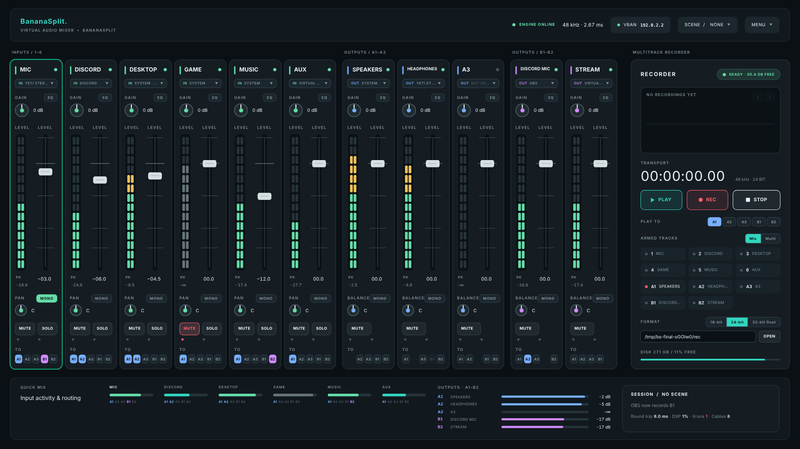

<div align="center">

# BananaSplit.

**A low-latency virtual audio mixer for Linux, Windows and macOS, in the spirit of Voicemeeter Banana.**

**[bananasplit.tech](https://bananasplit.tech)**

[](https://github.com/LudaLunizz/BananaSplit/actions/workflows/ci.yml)
[](https://github.com/LudaLunizz/BananaSplit/releases)
[](LICENSE)



*Ευχαριστώ, φίλε!*

</div>

> [!WARNING]
> BananaSplit is pre-alpha software. Expect rough edges and breaking changes.

## Features

- **6 input strips, 5 buses.** V1–V3 are mixes in between, B1 is the mic out (a virtual microphone for Discord, OBS, …) and B2 the system out on your default output. Any bus can play on a device, be a virtual mic, or both, and buses can feed each other (an input into V1, V1 into B2 but not B1: you hear it, the stream doesn’t). V1–V3 were called A1–A3 up to 2.8.24; those names are still read.
- **Per-channel menus** to pick devices, apps and a virtual cable for every channel.
- **Input gain, pan and a 6-band EQ** on every channel, with mute, solo and mono, and a **gate and compressor** on every input strip.
- **VBAN network audio**, compatible with Voicemeeter.
- **Multitrack recorder (MP3 or WAV) and player**, plus saved **scenes**.
- **Desktop app** with its own window and tray icon. Also runs in a terminal or headless as a service.
- **Updates itself** from the GitHub releases, installing only releases signed with BananaSplit's release key: on request (Menu ▸ Check for updates…), or automatically once you switch that on (off by default).

| Platform | Audio backend | Window |
| --- | --- | --- |
| Linux | JACK client on PipeWire's JACK layer or JACK2, PipeWire virtual cables | GTK 3 + WebKitGTK |
| Windows | WASAPI shared mode, Splitter or VB-Audio cables | WebView2 |
| macOS (new) | Core Audio, BlackHole and other loopback cables | WKWebView |

## Download

Builds are published on the [Releases](https://github.com/LudaLunizz/BananaSplit/releases) page.

| Platform | File |
| --- | --- |
| Debian, Ubuntu, Mint, Pop!_OS | `bananasplit_<version>_amd64.deb` |
| Any other Linux (x86-64, glibc ≥ 2.34) | `bananasplit-<version>-linux-x86_64.tar.gz` |
| Any Linux with Flatpak (x86-64) | `bananasplit-<version>-x86_64.flatpak` |
| Windows x64 | `bananasplit-<version>-windows-x64.zip` |
| macOS 11 or newer (Apple silicon and Intel) | `bananasplit-<version>-macos.zip` |

Every release ships a `SHA256SUMS.txt`.

Earlier versions, from vmix 1 to BananaSplit 2.7.0, are kept as they were published, one folder per version, in the [`history`](https://github.com/LudaLunizz/BananaSplit/tree/history) branch.

## Install

### Linux

**Debian and derivatives**

```sh
sudo apt install ./bananasplit_<version>_amd64.deb
```

**Other distributions (Arch, Fedora, openSUSE, …)**

```sh
tar -xzf bananasplit-<version>-linux-x86_64.tar.gz
cd bananasplit-<version>-linux-x86_64
./install.sh
```

This installs into `~/.local/bin` and your app menu without touching anything outside your home folder. `./install.sh --uninstall` removes it again.

**Flatpak (any distribution)**

```sh
flatpak install --user bananasplit-<version>-x86_64.flatpak
```

It brings its own dependencies; see the [Linux manual](linux/README.md#install) for what works differently in it.

Runtime dependencies:

| Distro | Audio (required) | Window and tray (recommended) |
| --- | --- | --- |
| Arch | `pipewire-jack libpulse` | `webkit2gtk-4.1` |
| Fedora | `pipewire-jack-audio-connection-kit pulseaudio-utils` | `webkit2gtk4.1` |
| openSUSE | `pipewire-libjack-0_3 pulseaudio-utils` | `libwebkit2gtk-4_1-0` |
| Debian/Ubuntu | `pipewire-jack pulseaudio-utils` | `libwebkit2gtk-4.1-0` |

Closing the window keeps the mixer running in the tray. Quit it from the tray icon or the window menu.

The full Linux manual covering configuration, latency tuning, VBAN and the recorder lives in [`linux/README.md`](linux/README.md).

### Control it from other programs

Every BananaSplit serves a small local HTTP API on `127.0.0.1:8790`, the one its own window uses: read the state and the meters, set faders, start a recording. It is described in [`docs/api.md`](docs/api.md).

### Windows

1. Install the [Microsoft Edge WebView2 Runtime](https://developer.microsoft.com/microsoft-edge/webview2/) if it is not already present.
2. Extract the zip and run `bananasplit.exe`. It is a single standalone program: no installer, no console window.
3. For per-channel virtual cables, install [Splitter](https://github.com/LudaLunizz/Splitter/releases), BananaSplit's own (a cable for every channel; a test build for now, see the [Windows manual](windows/README.md#virtual-cables)), or [VB-Audio CABLE](https://vb-audio.com/Cable/) (CABLE, CABLE-A … CABLE-D).

BananaSplit lives in the tray: closing the window keeps the mixer running there. **Install to Start Menu** and **Start with Windows** are in the app menu.

See [`windows/README.md`](windows/README.md) for paths and command-line options.

### macOS

The macOS app is new, so older releases don't have it.

1. Unzip `bananasplit-<version>-macos.zip` and drag **BananaSplit** into Applications.
2. Open it. The app isn't signed with an Apple Developer ID, so the first time macOS refuses to open it: allow it with **Open Anyway** in **System Settings › Privacy & Security**, as the [macOS manual](macos/README.md#installing) explains.
3. Allow the microphone when macOS asks.
4. For per-channel virtual cables, install [BlackHole](https://github.com/ExistentialAudio/BlackHole) (`brew install blackhole-2ch`).

BananaSplit lives in the menu bar: closing the window keeps the mixer running there. See [`macos/README.md`](macos/README.md) for devices, cables, paths and command-line options.

To build the app yourself on a Mac (Rust and Xcode's command line tools):

```sh
cd macos
sh packaging/bundle.sh       # dist/BananaSplit.app, for Apple silicon and Intel
```

## Repository layout

```
.
├── core/             shared mixer core (Rust crate, no dependencies): engine, EQ,
│                     dynamics, recorder, player, MP3, VBAN, scenes, config, terminal view
├── gui/              shared GUI layer (source files, not a crate): the HTTP server, the
│                     state and command API and the window process, compiled into each app
├── linux/            Linux app (Rust crate, JACK / PipeWire)
│   ├── src/
│   ├── tests/        unit, end-to-end, GUI and window tests
│   ├── packaging/    .deb and portable package builder
│   ├── contrib/      desktop entry, PipeWire snippets, systemd unit
│   └── assets/
├── windows/          Windows app (Rust crate, WASAPI / WebView2)
├── macos/            macOS app (Rust crate, Core Audio / WKWebView)
├── docs/
│   ├── api.md        the local HTTP API (checked against the real server by the e2e tests)
│   └── screenshots/
└── .github/          CI, release automation, templates
```

The Linux, Windows and macOS apps are separate crates. Each builds on its own, and all three use the mixer in `core/` through a path dependency (`bananasplit-core = { path = "../core" }`) and re-export it, so their code keeps writing `bananasplit::engine::...`. The GUI layer (`gui/`) is one source file set that each app compiles in with `#[path]`; what really differs between the systems is a small `gui_platform` module in each app (see [`gui/README.md`](gui/README.md)). The updater's platform-free half is in `core/`; its download and install half is still per app. `core/` is not a Cargo workspace on purpose: all three apps are packages named `bananasplit`, and each keeps its own `target/`, which the packaging scripts expect.

## Building from source

Requires Rust 1.88 or newer.

**Linux**

```sh
cd linux
cargo build --release
target/release/bananasplit --gui
```

**Windows**

```powershell
cd windows
cargo build --release
target\release\bananasplit.exe
```

**macOS**

```sh
cd macos
cargo build --release
target/release/bananasplit
```

## Testing

```sh
cd core
cargo test                          # the mixer's unit tests (also run on Windows and macOS in CI)
```

```sh
cd linux
cargo test                          # app unit tests and no-allocation tests
sh tests/e2e/run_e2e.sh             # real binary against a mock libjack (gcc, curl, python3)
sh tests/window/run_window_test.sh  # app window and tray on Xvfb (GTK 3, dbus-python, PyGObject)
node tests/gui/ui_check.js          # every GUI control in Chromium (Node.js, Playwright)
sh packaging/build-packages.sh      # builds and verifies the .deb and portable package
sh packaging/build-flatpak.sh       # builds and verifies the Flatpak (flatpak-builder)
```

```sh
cd macos
cargo test                          # unit and no-allocation tests
sh packaging/bundle.sh && sh tests/launch/smoke.sh dist/BananaSplit.app
                                    # builds the app, starts it, asks it, starts it again, quits it
```

```powershell
cd windows
cargo test                          # unit tests
pwsh tests/launch/smoke.ps1 -Exe target\release\bananasplit.exe
                                    # starts the app on the desktop: window, second start, close, quit
```

All of these run in CI on every push and pull request.

## Releasing

1. Bump `version` in `linux/Cargo.toml`, `windows/Cargo.toml` and `macos/Cargo.toml` (`core/` is never published and keeps its own version).
2. Tag the commit with the same version and push the tag:

   ```sh
   git tag v2.7.0
   git push origin v2.7.0
   ```

3. When the [release workflow](.github/workflows/release.yml) has finished, run this on the computer that has the release key:

   ```sh
   linux/packaging/sign-release.sh --release v2.7.0
   ```

4. Write the release's notes on GitHub, then untick pre-release.

The workflow builds the Linux packages, the Windows executable and the macOS app and writes `SHA256SUMS.txt`, but doesn't publish them. `sign-release.sh --release` does, with your own GitHub login (`gh`), so the release is made by your account:

- It takes the files that the workflow left for the tag, but only from a successful run of `release.yml` in this repository.
- It checks the files against `SHA256SUMS.txt` and that the key is one of the two in `core/src/release.rs` (`SIGNING_KEY`, or the backup `BACKUP_SIGNING_KEY`).
- It writes two lines above the checksums, `# BananaSplit <version>` and `# signed <day>`: from 2.8.25 the updater installs a release only when its signed list names that release's version. `sha256sum --check` skips these lines.
- It signs `SHA256SUMS.txt` and publishes everything, `SHA256SUMS.txt.sig` included, as a pre-release with generated notes.

For a release that already exists (the workflow published them itself up to 2.8.2), it only adds those lines to that release's `SHA256SUMS.txt`, signs it and uploads both files.

The in-app updater offers a release once it is published and **not** marked pre-release. It finds the files by their names (`bananasplit-<version>-linux-x86_64.tar.gz`, `bananasplit_<version>_amd64.deb`, `bananasplit-<version>-windows-x64.exe`, `bananasplit-<version>-macos.zip`) and installs a release only when its `SHA256SUMS.txt` is signed with the release key, so keep those names and `SHA256SUMS.txt`.

**The macOS app** is signed ad hoc only (Apple silicon runs nothing unsigned), not with an Apple Developer ID, and not notarized: macOS asks people once to allow it (**Open Anyway**).

**The release key** is kept off GitHub on purpose (not even as a secret), so the workflow can't sign. A release without `SHA256SUMS.txt.sig` is offered but never installed. Keep a backup of the key: without it, no installed BananaSplit can update itself to a new release. From 2.8.25 there is also a **backup key** (`BACKUP_SIGNING_KEY`), kept offline on a separate drive and never on the computer that signs releases. Its signature is accepted too, so if the release key is ever lost or leaked, the next release can be signed with the backup key and carry a new key pair.

## Contributing

Issues and pull requests are welcome. Please run the tests for the platform you touched before opening a pull request.

## License

Copyright © 2026 the BananaSplit authors.

BananaSplit is free software: you can redistribute it and/or modify it under the terms of the [GNU General Public License](LICENSE) as published by the Free Software Foundation, either version 3 of the License, or (at your option) any later version. It is distributed in the hope that it will be useful, but WITHOUT ANY WARRANTY; see the license for details.

Releases up to and including 2.8.22 were published under the MIT License and stay available under it.
