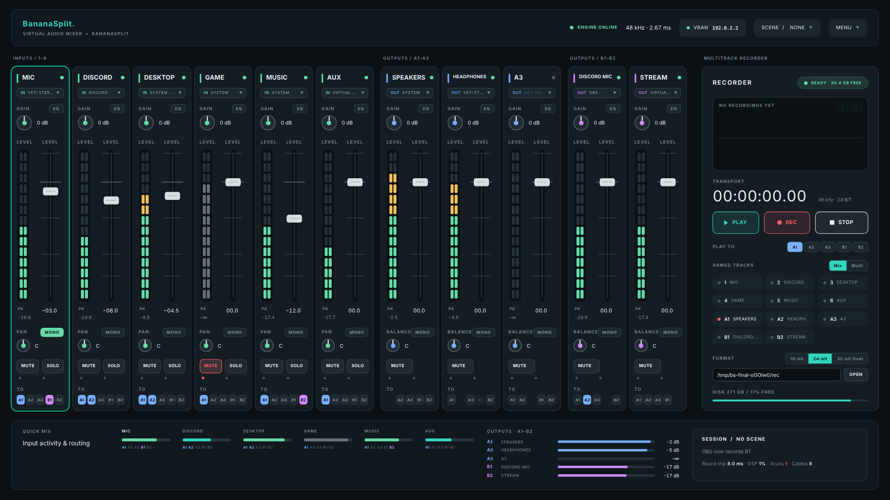

<div align="center">

# BananaSplit

**A low-latency virtual audio mixer for Linux and Windows, in the spirit of Voicemeeter Banana.**

[](https://github.com/LudaLunizz/BananaSplit/actions/workflows/ci.yml)
[](https://github.com/LudaLunizz/BananaSplit/releases)
[](LICENSE)



</div>

> [!WARNING]
> BananaSplit is pre-alpha software. Expect rough edges and breaking changes.

## Features

- **6 input strips, 5 buses.** A1–A3 play on speakers and headphones, B1–B2 act as virtual microphones. Any bus can be an output, a virtual mic, or both, and buses can feed each other.
- **Per-channel menus** to pick devices, apps and a virtual cable for every channel.
- **Input gain, pan and a 6-band EQ** on every channel, with mute, solo and mono.
- **VBAN network audio**, compatible with Voicemeeter.
- **Multitrack recorder and player**, plus saved **scenes**.
- **Desktop app** with its own window and tray icon. Also runs in a terminal or headless as a service.
- **Updates itself** from the GitHub releases, checking each download's SHA-256 first: on request (Menu ▸ Check for updates…), or automatically once you switch that on (off by default).

| Platform | Audio backend | Window |
| --- | --- | --- |
| Linux | JACK client on PipeWire's JACK layer or JACK2, PipeWire virtual cables | GTK 3 + WebKitGTK |
| Windows | WASAPI shared mode, VB-Audio cables | WebView2 |

## Download

Builds are published on the [Releases](https://github.com/LudaLunizz/BananaSplit/releases) page.

| Platform | File |
| --- | --- |
| Debian, Ubuntu, Mint, Pop!_OS | `bananasplit_<version>_amd64.deb` |
| Any other Linux (x86-64, glibc ≥ 2.34) | `bananasplit-<version>-linux-x86_64.tar.gz` |
| Windows x64 | `bananasplit-<version>-windows-x64.zip` |

Every release ships a `SHA256SUMS.txt`.

Earlier versions, from vmix 1 to BananaSplit 2.7.0, are kept as they were published, one folder per version, in the [`history`](https://github.com/LudaLunizz/BananaSplit/tree/history) branch.

## Install

### Linux

**Debian and derivatives**

```sh
sudo apt install ./bananasplit_<version>_amd64.deb
```

**Other distributions (Arch, Fedora, openSUSE, …)**

```sh
tar -xzf bananasplit-<version>-linux-x86_64.tar.gz
cd bananasplit-<version>-linux-x86_64
./install.sh
```

This installs into `~/.local/bin` and your app menu without touching anything outside your home folder. `./install.sh --uninstall` removes it again.

Runtime dependencies:

| Distro | Audio (required) | Window and tray (recommended) |
| --- | --- | --- |
| Arch | `pipewire-jack libpulse` | `webkit2gtk-4.1` |
| Fedora | `pipewire-jack-audio-connection-kit pulseaudio-utils` | `webkit2gtk4.1` |
| openSUSE | `pipewire-libjack-0_3 pulseaudio-utils` | `libwebkit2gtk-4_1-0` |
| Debian/Ubuntu | `pipewire-jack pulseaudio-utils` | `libwebkit2gtk-4.1-0` |

Closing the window keeps the mixer running in the tray. Quit it from the tray icon or the window menu.

The full Linux manual covering configuration, latency tuning, VBAN and the recorder lives in [`linux/README.md`](linux/README.md).

### Windows

1. Install the [Microsoft Edge WebView2 Runtime](https://developer.microsoft.com/microsoft-edge/webview2/) if it is not already present.
2. Extract the zip and run `bananasplit.exe`. It is a single standalone program: no installer, no console window.
3. For per-channel virtual cables, install [VB-Audio CABLE](https://vb-audio.com/Cable/) (CABLE, CABLE-A … CABLE-D).

BananaSplit lives in the tray: closing the window keeps the mixer running there. **Install to Start Menu** and **Start with Windows** are in the app menu.

See [`windows/README.md`](windows/README.md) for paths and command-line options.

## Repository layout

```
.
├── linux/            Linux app (Rust crate, JACK / PipeWire)
│   ├── src/
│   ├── tests/        unit, end-to-end, GUI and window tests
│   ├── packaging/    .deb and portable package builder
│   ├── contrib/      desktop entry, PipeWire snippets, systemd unit
│   └── assets/
├── windows/          Windows app (Rust crate, WASAPI / WebView2)
├── docs/
│   └── screenshots/
└── .github/          CI, release automation, templates
```

The Linux and Windows apps are separate crates that share most of their mixer code by copy. Each builds on its own.

## Building from source

Requires Rust 1.85 or newer.

**Linux**

```sh
cd linux
cargo build --release
target/release/bananasplit --gui
```

**Windows**

```powershell
cd windows
cargo build --release
target\release\bananasplit.exe
```

## Testing

```sh
cd linux
cargo test                          # unit and no-allocation tests
sh tests/e2e/run_e2e.sh             # real binary against a mock libjack (gcc, curl, python3)
sh tests/window/run_window_test.sh  # app window and tray on Xvfb (GTK 3, dbus-python, PyGObject)
node tests/gui/ui_check.js          # every GUI control in Chromium (Node.js, Playwright)
sh packaging/build-packages.sh      # builds and verifies the .deb and portable package
```

```powershell
cd windows
cargo test                          # unit tests
pwsh tests/launch/smoke.ps1 -Exe target\release\bananasplit.exe
                                    # starts the app on the desktop: window, second start, close, quit
```

All of these run in CI on every push and pull request.

## Releasing

1. Bump `version` in `linux/Cargo.toml` and `windows/Cargo.toml`.
2. Tag the commit with the same version and push the tag:

   ```sh
   git tag v2.7.0
   git push origin v2.7.0
   ```

The [release workflow](.github/workflows/release.yml) builds the Linux packages and the Windows executable, writes `SHA256SUMS.txt` and publishes a GitHub release.

The in-app updater offers a release once it is published and **not** marked pre-release (the workflow creates new releases as pre-releases: untick that when the release is ready for everyone). It finds the files by their names (`bananasplit-<version>-linux-x86_64.tar.gz`, `bananasplit_<version>_amd64.deb`, `bananasplit-<version>-windows-x64.exe`) and refuses a file without a checksum, so keep those names and `SHA256SUMS.txt`.

## Contributing

Issues and pull requests are welcome. Please run the tests for the platform you touched before opening a pull request.

## License

[MIT](LICENSE)
